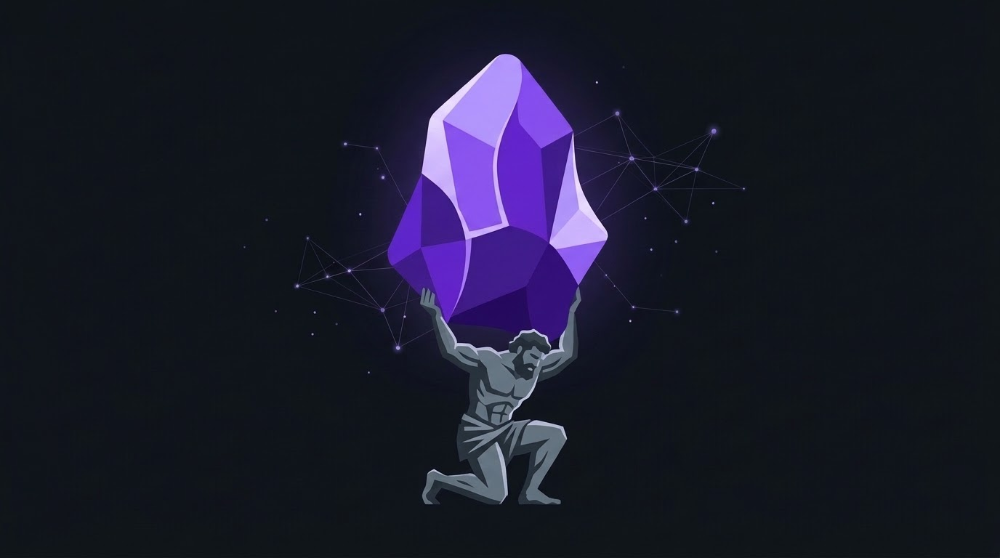
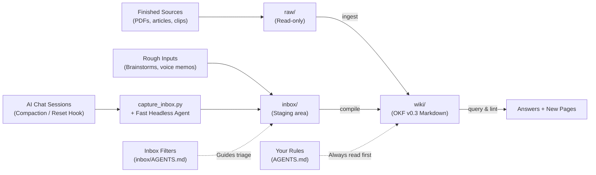

<p align="center">
  
</p>

<h1 align="center">atlasian</h1>

<p align="center">
  <a href="LICENSE"></a>
  <a href="#1-why-open-knowledge-format-okf-v03"></a>
  <a href="#quick-start"></a>
  <a href="#built-for-zero-lock-in"></a>
</p>

<p align="center">
  <strong>Stop losing ideas when your AI chat compacts.</strong>
</p>

`atlasian` is an open-source Agent Skill (`SKILL.md`). It turns your finished files, rough brainstorms, voice memos, and AI chat sessions into one living Markdown wiki.

No vector database. No background server. No vendor lock-in. Just plain Markdown and built-in Python.

---

## The Problem

AI agents work well inside one chat. Then context compaction happens, or you start a new session, and valuable decisions disappear.

Classic RAG tools also have a problem: they search raw text chunks from scratch on every question. They do not build lasting knowledge.

## The Solution: 3-Layer Living Wiki

`atlasian` separates **finished sources**, **rough ideas**, and **compiled knowledge** into three clean layers.



---

## Why `atlasian`? (3 Key Design Choices)

### 1. Why Open Knowledge Format (OKF v0.3)?

Andrej Karpathy's **LLM Wiki** gives a great workflow, but it leaves page metadata undefined. **[Open Knowledge Format (OKF v0.3)](https://github.com/open-knowledge-format/open-knowledge-format)** fills that gap with clean YAML frontmatter and standard Markdown links (`[Title](/folder/page.md)`).

With OKF v0.3, your agent gets **fast 2-step reading**—no embeddings and no vector database:

| Step | What the Agent Reads | Token Cost | Purpose |
| :--- | :--- | :--- | :--- |
| **Step 1 — Map** | `wiki/index.md` *(and `<folder>/index.md` when a folder grows past ~25–30 files)* | Low | Scans titles and one-line summaries, then picks only relevant pages |
| **Step 2 — Full Page** | Selected Markdown file(s) | Only when needed | Loads full details only for the exact pages needed to answer |

**100% user-controlled metadata:**
- OKF v0.3 strictly requires only `type` (and page types are completely user-defined).
- During setup (or anytime later), you choose which optional OKF v0.3 fields to enable (`title`, `description`, `tags`, `sources`, `generated`, `status`, `superseded_by`, `stale_after`, `verified`, `resource`, `usage_window`, `license`, or computation fields).
- Exact YAML syntax for every field lives in [`references/okf-v0.3-fields.md`](references/okf-v0.3-fields.md), so any AI agent writes valid OKF without guessing.
- Plain Markdown + standard links work natively in **Obsidian**, **GitHub**, **OKF visualizers**, and **any AI agent**.

### 2. Why Add `inbox/` to Karpathy's Method?

In Karpathy's pattern, `raw/` holds clean, read-only sources. Real daily work is messier than that.

You need a safe staging room for rough inputs before they enter `wiki/`:
- **Chat compaction & session-end notes** captured automatically by hooks
- **Quick brainstorm ideas** you drop in anytime
- **Voice memo transcripts** and unfinished rough drafts

`inbox/` keeps `raw/` pure and protects `wiki/` from noise. When you run `compile`, your agent filters out junk, merges strong ideas into `wiki/`, and cleans `inbox/`.

### 3. Why Optional `AGENTS.md` Rule Files?

Many skills force you to edit `SKILL.md` for personal preferences. When the repo updates, `git pull` causes merge conflicts.

`atlasian` cleanly separates the **shared skill engine** from **your personal rules**:
- `SKILL.md` stays minimal, shared, and portable across Claude Code, Hermes Agent, Codex, OpenCode, and other harnesses.
- `<wiki-root>/AGENTS.md` (optional) holds your enabled OKF v0.3 fields, custom page types, tone, and personal rules. `SKILL.md` always reads it first, and your rules always win.
- `<wiki-root>/inbox/AGENTS.md` (optional) holds your personal filter rules for what belongs in `inbox/`.

---

## Core Actions

| Action | Flow | What It Does |
| :--- | :--- | :--- |
| **`ingest`** | `raw/` → `wiki/` | Reads finished sources, creates or updates OKF pages, updates `wiki/index.md` and `wiki/log.md`. Never edits `raw/`. |
| **`compile`** | `inbox/` → `wiki/` | Reviews chat notes, brainstorms, and voice transcripts. Keeps strong ideas, updates `wiki/`, and cleans `inbox/`. |
| **`query`** | `wiki/` → Answer | Scans `wiki/index.md`, opens only matching pages, answers with links, and optionally saves strong insights back to `wiki/`. |
| **`lint`** | `wiki/` → Health check | Finds conflicts, stale claims, orphan pages, broken links, and folders ready for lazy splitting. |

---

## Harness-Agnostic Auto-Capture

Every AI harness uses a different hook format. `atlasian` keeps hooks thin (one line) and puts all logic in one zero-dependency Python script (`scripts/capture_inbox.py`):

1. **Fast one-time setup (`SETUP.md`)**: Your agent asks 3 short questions (wiki folder name, OKF fields/types, and auto-capture CLI/model), creates your wiki (default: `llm-wiki`), and wires a one-line hook. Once configured, `SKILL.md` never opens `SETUP.md` again.
2. **Pre-compaction preferred, post-compaction supported**: Hooks before compaction (such as `PreCompact`) keep raw details intact; after-compaction hooks (such as Hermes `session:compress`) and session end/reset hooks are also supported.
3. **Restricted worker safety**: The fast headless triage agent only needs `Read` and `Write`/`Edit` access inside `<wiki-root>/inbox/`—no shell, no web, and no writes to `raw/` or `wiki/`.
4. **6 built-in reliability guards**:
   - **Loop guard**: Stops infinite hook chains with `ATLASIAN_CAPTURE_ACTIVE=1`.
   - **Non-blocking run**: Detaches to a background worker immediately so `/compact` or exit never freezes.
   - **Exclusive lockfile**: Serializes concurrent hooks via `.llm-wiki/inbox.lock` so `inbox/index.md` never corrupts.
   - **Delta watermark**: Tracks processed byte offsets in `.llm-wiki/state.json` to prevent duplicate notes.
   - **Compaction context tagging**: Labels prior compaction summaries as context-only so Hook #2 understands earlier context without duplicating Hook #1.
   - **3-minute timeout + max 3 retries + failed-session recovery**: Automatically retries failed or timed-out runs (up to 3 attempts). If all 3 fail (for example offline or API outage), the watermark is preserved and the session is queued in `.llm-wiki/failed.json` for automatic catch-up on the next successful hook or manual recovery via `--retry-failed`.

---

## Built for Zero Lock-In

- **Plain Markdown files**: Readable anywhere, forever, with zero proprietary formats or databases.
- **Zero external dependencies**: Uses only Python 3.9+ standard library.
- **Portable across agents**: Built on open `SKILL.md` (`agentskills.io`) and OKF v0.3 standards.

---

## Quick Start

1. **Clone the skill** into your agent's skills folder:

```bash
git clone https://github.com/siberhan/atlasian.git
```

2. **Run one-time setup** by telling your AI agent:

> "Set up the atlasian skill for me."

Your agent reads `SETUP.md`, asks 3 quick questions, creates your wiki folder (default `llm-wiki`, or any name you pick), and optionally connects auto-capture hooks for your harness.

### Run Tests

Verify the capture runner locally with Python's built-in `unittest`:

```bash
python3 -m unittest discover -s tests -v
```

---

## Repository Structure

```text
atlasian/
├── LICENSE                         # MIT License
├── README.md                       # Project overview
├── SKILL.md                        # Core skill engine (Karpathy LLM Wiki + OKF v0.3)
├── SETUP.md                        # Harness-agnostic one-time setup guide
├── atlasian.jpg                    # Hero banner artwork
├── prompts/
│   └── inbox-triage.md             # System prompt for the headless inbox triage worker
├── references/
│   ├── okf-v0.3-fields.md          # Complete OKF v0.3 frontmatter YAML reference
│   └── hermes-hooks.md             # Hermes Agent shell-hooks + state.db setup guide
├── scripts/
│   └── capture_inbox.py            # Zero-dependency hook runner with 6 safety guards
└── tests/
    └── test_capture_inbox.py       # Built-in unit tests for capture_inbox.py
```

### User Wiki Layout (Created at Setup)

```text
<wiki-root>/                        # Default: llm-wiki (customizable at setup)
├── AGENTS.md                       # Optional personal rules & active OKF fields (read first)
├── .llm-wiki/
│   ├── capture.json                # Auto-capture config (180s timeout, max 3 retries)
│   └── state.json                  # Per-session delta watermarks
├── raw/                            # Read-only finished sources (PDFs, articles, clips)
├── inbox/                          # Staging area: hook notes, brainstorms, voice transcripts
│   ├── AGENTS.md                   # Optional inbox filter rules
│   └── index.md                    # Active rough topic drafts in inbox/
└── wiki/                           # OKF v0.3 compiled knowledge base
    ├── index.md                    # Content map (read first, declares okf_version: "0.3")
    └── log.md                      # Chronological activity log
```

---

## Inspirations & Standards

- **Andrej Karpathy** — LLM Wiki pattern (`raw/`, `wiki/`, `index.md`, `log.md`, `ingest`/`query`/`lint`)
- **[Open Knowledge Format (OKF v0.3)](https://github.com/open-knowledge-format/open-knowledge-format)** — Open, vendor-neutral Markdown + YAML knowledge standard

---

## License

MIT License — see [LICENSE](LICENSE) for details.
