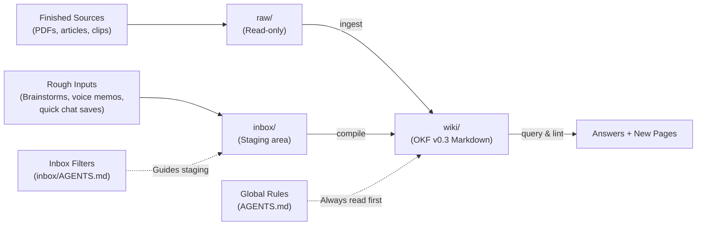

<p align="center">
  
</p>

<h1 align="center">atlasian</h1>

<p align="center">
  <a href="LICENSE"></a>
  <a href="#1-why-open-knowledge-format-okf-v03"></a>
  <a href="#quick-start"></a>
  <a href="#built-for-zero-lock-in"></a>
</p>

<p align="center">
  <strong>Turn your sources, brainstorms, voice memos, and AI decisions into one living Markdown wiki.</strong>
</p>

`atlasian` is an open-source Agent Skill (`SKILL.md`). It works with any AI coding or chat agent (Claude Code, Hermes Agent, Codex, Antigravity, OpenCode, Cursor).

No vector database. No background server. No hook scripts. No vendor lock-in. Just plain Markdown.

---

## The Problem

AI agents work well inside one chat. Then you open a new session, and past decisions, research, and ideas scatter across old chats and random notes.

Classic RAG tools also fall short: they search raw text chunks from scratch on every question. They do not build lasting, interlinked knowledge.

## The Solution: 3-Layer Living Wiki

`atlasian` separates **finished sources**, **rough ideas**, and **compiled knowledge** into three clean layers.



---

## Why `atlasian`? (3 Key Design Choices)

### 1. Why Open Knowledge Format (OKF v0.3)?

Andrej Karpathy's **LLM Wiki** gives a great workflow, but it leaves page metadata undefined. Google's **[Open Knowledge Format (OKF v0.3)](https://github.com/open-knowledge-format/open-knowledge-format)** fills that gap with clean YAML frontmatter and standard relative Markdown links (`[Title](./page.md)`).

With OKF v0.3, your agent gets **fast 2-step reading**—no embeddings and no vector database:

| Step | What the Agent Reads | Token Cost | Purpose |
| :--- | :--- | :--- | :--- |
| **Step 1 — Map** | `wiki/index.md` *(and `<folder>/index.md` for topic folders or large folders)* | Low | Scans titles and one-line summaries, then picks only relevant pages |
| **Step 2 — Full Page** | Selected Markdown file(s) | Only when needed | Loads full details only for the exact pages needed to answer |

**100% user-controlled metadata:**
- OKF v0.3 strictly requires only `type` (and page types are completely user-defined).
- During setup (or anytime later), you choose which optional OKF v0.3 fields to enable (`title`, `description`, `tags`, `sources`, `generated`, `status`, `superseded_by`, `stale_after`, `verified`, `resource`, `usage_window`, `license`, or computation fields).
- Exact YAML syntax for every field lives in [`references/okf-v0.3-fields.md`](references/okf-v0.3-fields.md), so any AI agent writes valid OKF without guessing.
- Plain Markdown + relative links work natively in **Obsidian**, **GitHub**, **OKF visualizers**, and **any AI agent**.

### 2. Why Add `inbox/` to Karpathy's Method?

In Karpathy's pattern, `raw/` holds clean, read-only sources. Real daily work is messier than that.

You need a safe staging room for rough inputs before they enter `wiki/`:
- **Quick brainstorm ideas** you drop in anytime
- **Voice memo transcripts** and unfinished rough drafts
- **Decisions and notes** you ask your agent to save during a chat

`inbox/` keeps `raw/` pure and protects `wiki/` from noise. When you run `compile`, your agent filters out junk, merges strong ideas into `wiki/`, and cleans `inbox/`.

### 3. Why Optional `AGENTS.md` Rule Files?

Many skills force you to edit `SKILL.md` for personal preferences. When the repo updates, `git pull` causes merge conflicts.

`atlasian` cleanly separates the **shared skill engine** from **your personal rules**:
- `SKILL.md` stays minimal, shared, and portable across every agent harness.
- `<wiki-root>/AGENTS.md` (optional) holds your global rules, enabled OKF v0.3 fields, custom page types, and tone. `SKILL.md` always reads it first, and your rules always win.
- `<folder>/index.md` holds folder-specific rules (so root `AGENTS.md` never bloats as you add projects).
- `<wiki-root>/inbox/AGENTS.md` (optional) holds your personal filter rules for `inbox/`.

---

## Core Actions

| Action | Flow | What It Does |
| :--- | :--- | :--- |
| **`capture`** | Chat → `inbox/` or `wiki/` | Saves a decision, idea, or note from your current chat whenever you ask. |
| **`ingest`** | `raw/` → `wiki/` | Reads finished sources, creates or updates OKF pages, updates `wiki/index.md` and `wiki/log.md`. Never edits `raw/`. |
| **`compile`** | `inbox/` → `wiki/` | Reviews rough brainstorms, voice transcripts, and saved chat notes. Keeps strong ideas, updates `wiki/`, and cleans `inbox/`. |
| **`query`** | `wiki/` → Answer | Scans `wiki/index.md`, opens only matching pages, answers with links, and optionally saves strong insights back to `wiki/`. |
| **`lint`** | `wiki/` → Health check | Finds conflicts, stale claims, orphan pages, broken links, and folders ready for lazy splitting. |

---

## Built for Zero Lock-In

- **Plain Markdown files**: Readable anywhere, forever, with zero proprietary formats or databases.
- **Zero scripts or dependencies**: 100% pure Markdown instructions—works on any OS and any AI harness without installing packages or background daemons.
- **Portable across agents**: Built on open `SKILL.md` (`agentskills.io`) and OKF v0.3 standards.

---

## Quick Start

1. **Clone the skill** into your agent's skills folder:

```bash
git clone https://github.com/siberhan/atlasian.git
```

2. **Run one-time setup** by telling your AI agent:

> "Set up the atlasian skill for me."

Your agent reads `SETUP.md`, asks 2 quick questions (wiki folder name + OKF fields and page types), and creates your wiki folder (default: `llm-wiki`, or any name you pick). Once configured, `SKILL.md` never opens `SETUP.md` again.

---

## Repository Structure

```text
atlasian/
├── LICENSE                         # MIT License
├── README.md                       # Project overview
├── SKILL.md                        # Core skill engine (Karpathy LLM Wiki + OKF v0.3)
├── SETUP.md                        # One-time interactive setup guide
├── atlasian.jpg                    # Hero banner artwork
└── references/
    └── okf-v0.3-fields.md          # Complete OKF v0.3 frontmatter YAML reference
```

### User Wiki Layout (Created at Setup)

```text
<wiki-root>/                        # Default: llm-wiki (customizable at setup)
├── AGENTS.md                       # Optional global rules & active OKF fields (read first)
├── raw/                            # Read-only finished sources (PDFs, articles, clips)
├── inbox/                          # Staging area: brainstorms, voice transcripts, quick saves
│   ├── AGENTS.md                   # Optional inbox filter rules
│   └── index.md                    # Active rough topic drafts in inbox/
└── wiki/                           # OKF v0.3 compiled knowledge base
    ├── index.md                    # Content map (read first, declares okf_version: "0.3")
    └── log.md                      # Chronological activity log
```

---

## Inspirations & Standards

- **Andrej Karpathy** — LLM Wiki pattern (`raw/`, `wiki/`, `index.md`, `log.md`, `ingest`/`query`/`lint`)
- **[Open Knowledge Format (OKF v0.3)](https://github.com/open-knowledge-format/open-knowledge-format)** — Open, vendor-neutral Markdown + YAML knowledge standard

---

## License

MIT License — see [LICENSE](LICENSE) for details.
